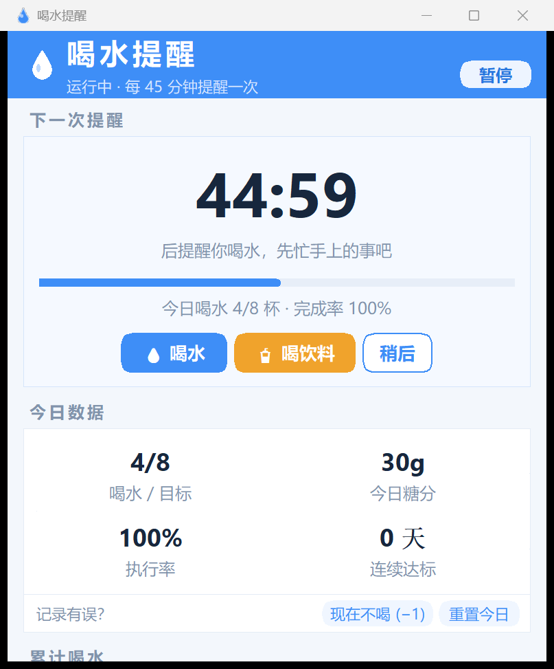
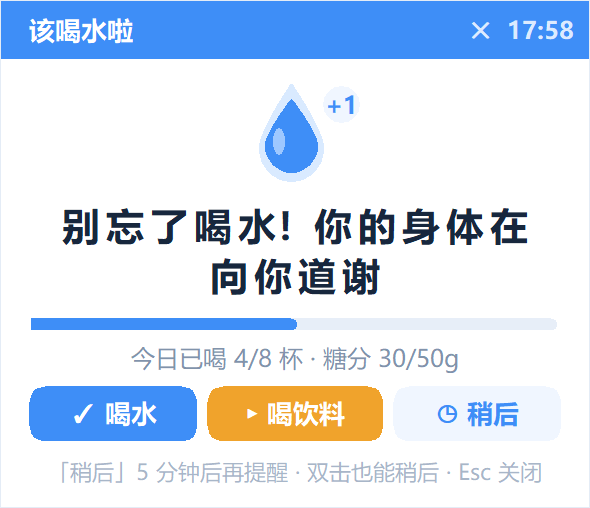
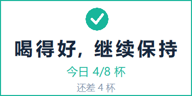
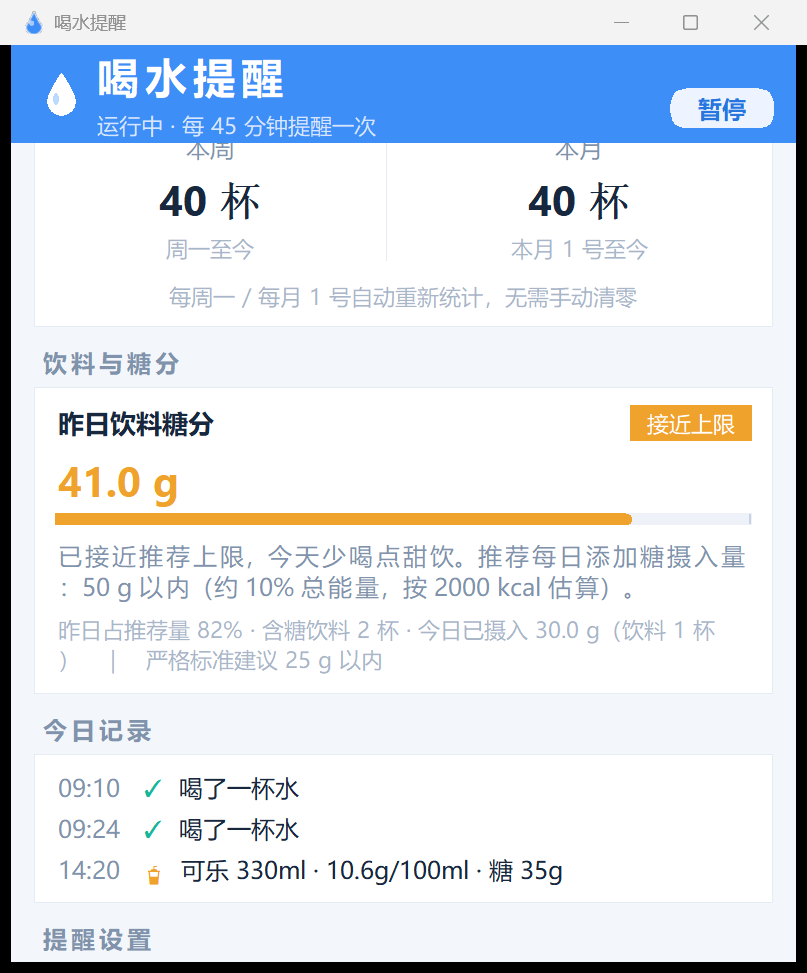
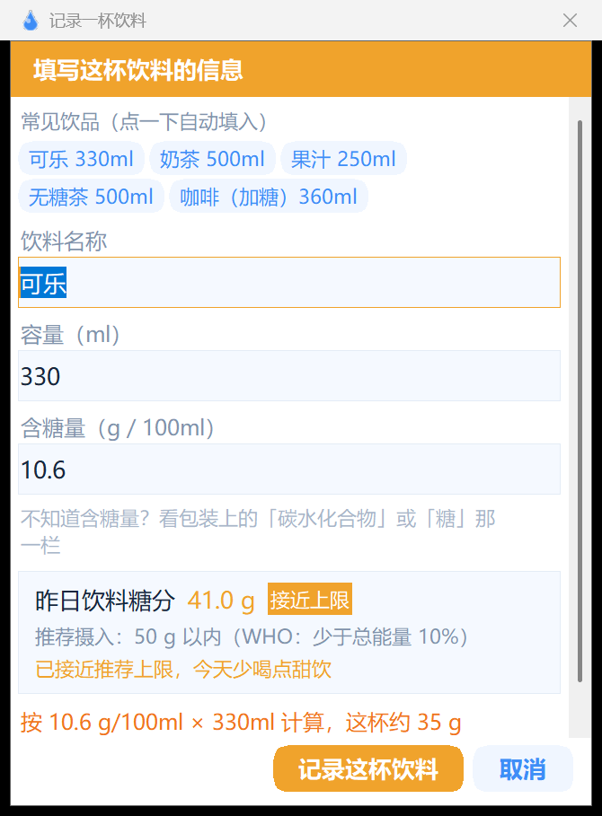
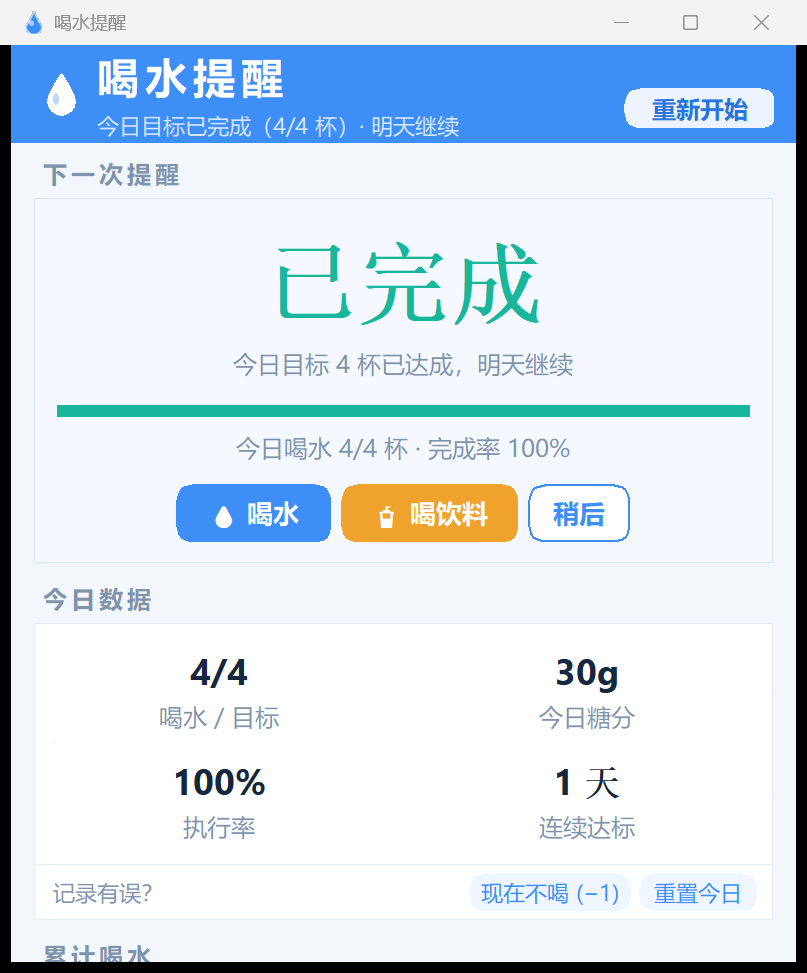

# 💧 喝水提醒

一个简洁美观的 Windows 喝水提醒小工具：打开后挂在后台（任务栏 / 系统托盘），
每隔一段时间弹出提醒卡片，提醒你起来喝杯水；点一下就能记下这杯水，也能记录含糖饮料并给出健康建议。

只用 Python 标准库（tkinter）实现，**无需安装任何第三方依赖**。

 

---

## 快速开始

| 文件 | 说明 |
| --- | --- |
| `启动喝水提醒.vbs` | **推荐**：后台启动，不显示黑色控制台窗口 |
| `启动喝水提醒.bat` | 备选启动方式（需要 `pythonw` 在 PATH 中） |
| `water_reminder.py` | 程序本体，也可直接 `python water_reminder.py` 调试运行 |

双击 `启动喝水提醒.vbs` 即可，也可以双击桌面上的「喝水提醒」快捷方式。

> 需要 Windows 上已安装 **Python 3.8+**（官方安装包自带 tkinter）。
> 如果双击后没反应，可用 `python water_reminder.py` 在命令行里运行，查看报错信息。

## 功能

### 1. 喝水量统计（今日 / 本周 / 本月）

- **「喝水」按钮**：每点一次，今日杯数 +1，本周、本月累计同时 +1（一杯按 250ml 估算）。
  - 点击后弹出**正向反馈小窗**（绿色对勾 + 今日进度 + 剩余杯数，1.7 秒后淡出），并有一声提示音；
  - 随后 **3 秒内按钮变灰不可再点**，防止手抖连点记成好几杯。
- **「喝饮料」按钮**：记录一杯含糖饮料，**同样计入喝水杯数**（饮料也是液体摄入），并单独累计糖分。
- **「现在不喝 (−1)」**：仅在今天已喝过水（≥1 杯）时**高亮可点**；杯数为 0 或点完之后立即**变灰不可点**。
  减去的是**最近那一杯**，并**同时扣掉它对应的含糖量**：
  如果最后一杯是饮料，今日糖分和饮料杯数一并回退（提示会写明扣掉了多少克糖）；如果是一杯水，则只减杯数。
  多杯按「后进先出」顺序回退，可连续点直到归零。
- **「重置今日」**：把今天的**杯数和糖分一起清零**（今日记录也清空，方便重新开始统计）；
  本周 / 本月仍保留之前各天的记录。
- **本周 / 本月累计**按日期自动汇总：**每周一 0 点、每月 1 号 0 点自动重新统计**，无需手动清零；
  跨天时「今日」也会自动归零，数据不会串到第二天。
- 今日数据卡片：喝水 / 目标、今日糖分、执行率、连续达标天数。



### 2. 饮料与糖分

点「喝饮料」（主界面或提醒弹窗里都有）会弹出记录窗口：

- 填 **容量（ml）** 和 **含糖量（g / 100ml）**，常用饮品有快捷预设（可乐、奶茶、果汁、无糖茶、加糖咖啡）。
  按包装上的「每 100 毫升含糖量」填写即可，程序按 `含糖量 × 容量 ÷ 100` 自动换算成这杯实际摄入的糖克数。
- 窗口里直接显示 **昨日饮料糖分**、健康评级（良好 / 接近上限 / 偏高 / 明显超标）和
  **推荐摄入量**：`50 g 以内`（WHO 建议添加糖少于总能量的 10%，按每日 2000 kcal 估算；
  严格标准为 25 g，即总能量的 5%）。
- 还会实时提示「按 x g/100ml × y ml 计算，这杯约 z g 糖；记录后今日糖分…占推荐量…%」。
- **窗口是标准窗口（带标题栏），任何时候都能自由编辑**：三个输入框都可以直接点进去
  用键盘修改、删除、重输；反复打开多次、先关闭再打开、从提醒弹窗点进来，都能正常输入。
  窗口会**贴在主界面旁边**显示，主界面移动时会跟着走。
- 主界面的「饮料与糖分」卡片用进度条展示昨日糖分相对推荐量的比例，并列出今日已摄入糖分与饮料杯数。
- 今日记录里会列出每一次喝水 / 饮料 / 跳过的时间与详情（饮料会显示每 100ml 含糖量）。




### 3. 定时提醒与后台常驻

- **定时弹窗**：默认每 45 分钟提醒一次，可调 1 ~ 480 分钟。
- **弹窗紧跟主界面**：提醒卡片出现在主界面旁边（主界面收在托盘里时回到屏幕右下角），
  主界面移动或缩放时弹窗会**跟着移动**；卡片顶部显示当前时间，并带一条今日进度条。
- **达成今日目标后自动停止计时**：喝够目标杯数后倒计时区会变成绿色的「已完成」，
  当天不再弹出提醒；点右上角「重新开始」可手动恢复计时（杯数记录保留）。
  用「现在不喝 (−1)」或「重置今日」把杯数降回目标以下，也会自动恢复计时。



- 提醒卡片三个按钮：**喝水**（记一杯并重新计时）、**喝饮料**（直接打开记录窗口）、**稍后**（推迟 5 分钟，可配置）。
- 双击卡片或按 `Esc` 只关掉当前弹窗，倒计时照常继续。
- **温和提醒**：到点只闪烁任务栏图标，不抢焦点（默认开启）。
- **后台常驻（关闭即收进系统托盘）**：点窗口右上角的关闭键后程序**不会退出**，
  而是**最小化到系统托盘**继续计时，右下角会出现一个**蓝色水滴托盘图标**。
  - **单击**托盘图标 → 恢复主界面
  - **右键**托盘图标 → 打开主界面 / 暂停或继续提醒 / 记录一杯水 / **关闭程序**（真正退出）
  - 程序内没有自建的关闭按钮，标题栏的 × 与托盘菜单是唯一的两个入口
- **兜底**：万一系统托盘不可用（例如资源管理器异常），点关闭会退化为「最小化到任务栏」并给出提示，
  保证窗口在任何情况下都能找回来。
- **再次双击启动不会开出第二份**：即使程序正收在系统托盘里，也会把原来那个窗口唤回前台。
- **开机自动启动**：界面里打开开关即可。

### 4. 提醒设置栏

界面的「提醒设置」区域集中管理四项：

| 设置项 | 操作方式 |
| --- | --- |
| **提醒间隔**（1 ~ 480 分钟） | 拖滑块，或点右侧 **− / +**（每次 5 分钟）；中间实时显示当前值 |
| **每日目标**（1 ~ 24 杯） | 同上，每次 1 杯 |
| **温和提醒** | 右侧开关，开启后到点只闪任务栏、不抢焦点 |
| **开机自动启动** | 右侧开关，登录 Windows 后自动在后台开始提醒 |

- 滑块两端标出最小 / 最大值，当前进度一目了然。
- 所有改动**立即生效并自动保存**；拖动与 ± 步进都会同步更新显示，不会出现数值与滑块不一致。

### 5. 放大字号（2 倍）+ 更舒展的间距

- 所有文字按 **2 倍**放大：正文约 26px、按钮约 26px、倒计时约 92px。
- **字距更宽**：标题与正文的中文之间加入细微字距，数字、百分号、单位保持原样不被拆散。
- 窗口按屏幕比例给出舒适的初始大小，内容可滚动；提醒弹窗与「记录饮料」窗口都会**按内容自适应大小**，
  按钮固定可见、不会被挤出屏幕。
- 如需调整字号，改 `water_reminder.py` 顶部的 `FONT_BOOST = 2.0`
  （`1.18` = 小字号，`4.0` = 超大字号）。

### 6. 其它

- 自定义提醒语（最多 40 条，随机轮播）、每日目标（1~24 杯）、高 DPI 适配。
- 设置与数据保存在同目录 `config.json`，随改随存。

## 配置说明（`config.json`）

| 字段 | 含义 | 默认值 |
| --- | --- | --- |
| `interval_min` | 提醒间隔（分钟），1 ~ 480 | `45` |
| `goal` | 每日目标杯数，1 ~ 24 | `8` |
| `snooze_min` | 点「稍后」推迟的分钟数，1 ~ 60 | `5` |
| `gentle` | 温和提醒（只闪任务栏，不抢焦点） | `true` |
| `autostart` | 开机自动启动 | `false` |
| `kcal_per_day` | 每日总能量估算，用于计算推荐糖量（1200 ~ 4000） | `2000` |
| `sugar_ratio` | 推荐糖量占能量比例（%），10 = WHO 标准，5 = 严格 | `10` |
| `quotes` | 提醒语轮播列表 | 内置 8 句 |
| `data.log` | 按日期保存的明细：喝水杯数、饮料糖分、饮料列表（保留约 400 天） | 自动维护 |
| `data.water_fix` | 当天「减一杯 / 重置」的修正量 | 自动维护 |

> 周 / 月统计、昨日糖分都由 `data.log` 按日期实时汇总，所以跨周、跨月会自动从 0 开始，
> 不需要手动清零；历史明细超过保留期会自动清理，文件不会无限变大。

## 常见问题

**双击 `.vbs` 没反应？**
说明系统里找不到 `pythonw.exe`。请用 `启动喝水提醒.bat`，或安装官方 Python（勾选 *Add Python to PATH*）。

**关掉窗口后程序还在吗？**
在的。点 × 只是**收进系统托盘**，计时和提醒照常进行；单击右下角托盘区的蓝色水滴即可恢复窗口。

**「喝饮料」窗口里的数字改不了？**
已修复。窗口现在是标准窗口（带标题栏），可正常获得键盘焦点，三个输入框都能随意修改。

**窗口太大 / 想改回小字号？**
把 `water_reminder.py` 里的 `FONT_BOOST = 2.0` 改成 `1.18`（小）或 `4.0`（超大），重新启动即可。

**点错了「喝水」怎么撤销？**
在「今日数据」卡片点「现在不喝 (−1)」减去最近一杯（若是饮料会连带扣掉它的糖分），
或点「重置今日」把今天的杯数和糖分一起清零。

**为什么本周 / 本月数字和今天对不上？**
本周（周一至今）和本月（1 号至今）是这段时间内的累计值，包含之前各天的记录，因此通常大于今日杯数。

**糖分的推荐量怎么来的？**
WHO 建议添加糖摄入少于总能量的 10%，最好低于 5%。按 2000 kcal 估算即约 50 g（严格 25 g）。
可在 `config.json` 里改 `kcal_per_day` 和 `sugar_ratio` 来适配自己的情况。

**找不到托盘图标？**
先看任务栏右下角的「隐藏的图标」小箭头里（Windows 默认会折叠部分图标，可把水滴拖到任务栏常驻）。
若系统托盘确实不可用，点关闭会自动退化为「最小化到任务栏」，从任务栏点一下即可恢复。
也可以重新双击启动文件，会把已有窗口叫到前台。

**彻底退出程序？**
右键托盘图标 →「关闭程序」。

## 目录结构

```
喝水提醒/
├── water_reminder.py      # 程序本体（单文件，无第三方依赖）
├── 启动喝水提醒.vbs        # 无窗口后台启动
├── 启动喝水提醒.bat        # 备选启动
├── 预览图/                # 截图
└── config.json            # 首次运行自动生成（设置 + 统计）
```
